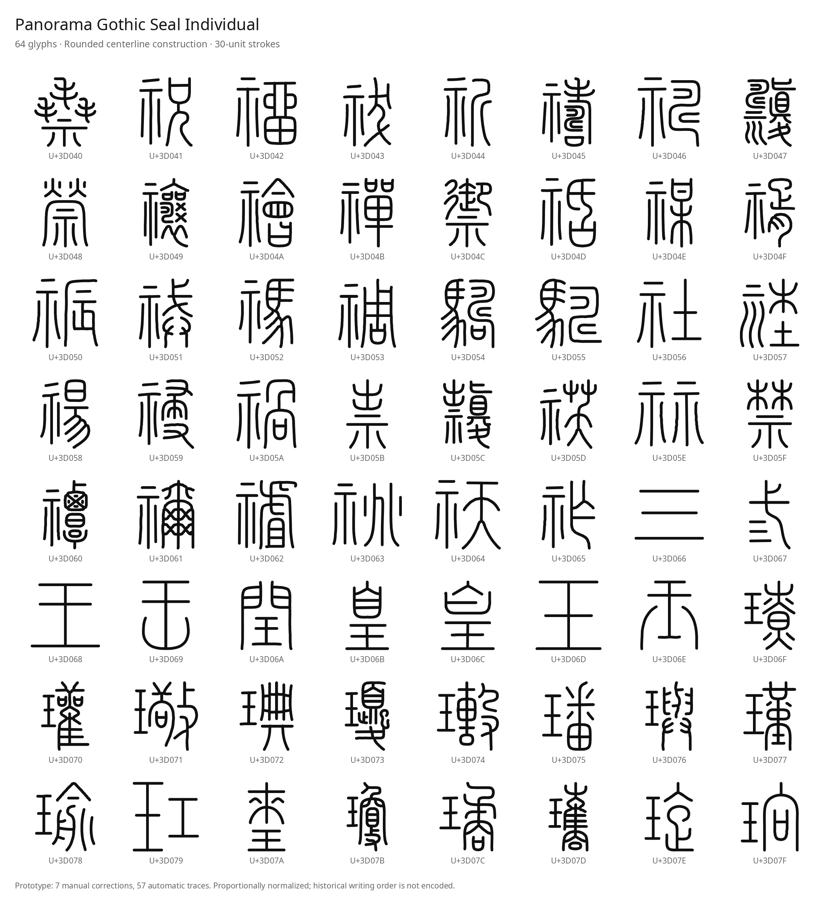

# Panorama Gothic

A sans-serif font family and supplements targeting the **Unicode 18.0.0**. This project prioritizes authentic character shapes for codepoints missing from Noto. Hex labels, tofu boxes and other placeholders do not count toward coverage.

The active Small Seal goal is the **entire 11,328-character range,
U+3D000–U+3FC3F**. See the [workspace progress snapshot](design/quality/small-seal-progress.json)
and [creation and review criteria](design/quality/SMALL-SEAL-GOAL.md). The
snapshot distinguishes generated drawings, pending reviews and frozen accepted
geometry; a new batch is published after review. The downloadable v0.6 sample
below remains available while the remaining characters are created.

## Unicode 18 continuation

The Small Seal target is pinned to the published Unicode 18.0.0 UCD in
`reference/ucd-18/`, with source URLs and SHA-256 fingerprints. Scripts.txt and
Blocks.txt agree on all 11,328 target characters. The chart PDF still matches
its recorded fingerprint. The original 128 glyphs' outlines and spacing are
preserved exactly in the expanded development font.

The [current development font](fonts/seal-individual/PanoramaGothicSealIndividual-Regular.ttf?raw=1)
and [preview](fonts/seal-individual/preview-504.png) contain 504 independently reviewed glyphs.
The [progress audit](design/quality/small-seal-progress.json) reports accepted
geometry separately from drawings and pending candidates; its timestamp and
fingerprints identify the evidence it assessed.

Four generation subagents are each assigned 64 distinct characters in
[current-wave.json](design/quality/current-wave.json). Every new glyph receives
independent native and actual-font review before frozen acceptance. Native
mismatches remain recorded even where reviewed vector repairs restore the
required structure. Candidate presence alone never grants coverage.

Private immutable font proofs can be prepared with `tools/prepare_seal_review.py`.
The published 128-character v0.6 package remains a historical sample; it does
not claim full-block completion. Earlier counts of 154 drawings included
unpublished files absent from the recovered GitHub branch.

## Small Seal: independent drawings and real strokes

The **historical version 0.6 design sample contains 128 characters, U+3D000–U+3D07F**. Each character gets its own `image_gen.imagegen` drawing informed by all available **THX, CCZ, QJZ and DYC** specimens in the official Unicode chart. The new U+3D040–U+3D07F page uses 243 of 256 possible chart specimens; missing specimens remain marked unavailable. Where historical variants differ, a coherent attested construction is chosen; incompatible components are not blended. The first 64 characters' source PNG, JSON and SVG files are preserved unchanged in this expansion.

The original generated PNGs and complete prompts are preserved in `design/seal-individual/`. Separate visual reviews record branches, counters, detachments, specimen availability and the exact PNG hash. A drawing that loses a component is rejected. Any subsequent manual correction to the font geometry is explicitly recorded; it does not turn the rejected PNG into an approved drawing.

The font source is **editable Bézier centerlines**, stored as JSON and SVG in `design/strokes-individual/`. Automatic tracking follows the skeleton of the new drawing; hand-reviewed overrides take precedence. The reference font outlines and brush perimeters are not used to construct the new font. TrueType stores the constant-radius expansion of these centerlines as filled outlines, with round caps and joins.

Each complete glyph is scaled proportionally to a maximum centerline dimension of **738 units**, centered at **(512, 320) in font coordinates** within its 1024-unit em. This keeps each glyph's internal proportions and applies the same transform at every weight. The shared pen width is independent of that scale: **Regular 400 uses 30 units**, giving a maximum ink dimension of **768 units**. Editable source files retain their reviewed nominal width of 43 units.

The native generated drawing remains the main guide for trajectories, shape and proportions. Minimal vector overrides address confirmed structural or tracing defects while preserving the original PNG and other stroke courses. These overrides receive independent review in the compiled font. U+3D034, for example, adds the missing left descending leg beneath its upper shoulder.



- [Full 128-character preview](fonts/seal-individual/preview-128.png)
- [Weight comparison](fonts/seal-individual-variable/weight-comparison.png)
- [Regular TTF](fonts/seal-individual/PanoramaGothicSealIndividual-Regular.ttf?raw=1)
- [Variable TTF](fonts/seal-individual-variable/PanoramaGothicSealIndividualVariable.ttf?raw=1)
- [Font and editable-source package](dist/Panorama-Gothic-Seal-Stroke-128.zip?raw=1)
- [Stroke construction example](fonts/seal-individual/stroke-comparison.png)
- [Download path replay](fonts/seal-individual/stroke-playback.html?raw=1) and open it locally
- [Download weight slider](fonts/seal-individual-variable/weight-slider.html?raw=1), keep the variable TTF beside it, and open it locally
- [Editable SVG example](design/strokes-individual/U3D001.svg)

The geometry of U+3D001 is manually reviewed, including its smooth stem-to-tail curve and detached lower bar. The other glyphs' manual/automatic status and targeted repairs are recorded individually. Validation combines reference review of all **128 sample glyphs at default Regular 400** with `tools/verify_glyph_invariants.py`, which checks recorded structural features in the rendered static and variable fonts. Rules cover details such as bar relationships, branches and open spaces; their recorded weight scopes vary. Some dense-form rules apply only at 300 and 400.

`tools/verify_source_reviews.py` checks the full `design/quality/accepted-geometry.json` registry and rejects changed geometry or source PNG hashes until renewed visual review. `tools/verify_normalized_sizes.py --registry design/quality/accepted-geometry.json` checks actual font bounds, centering, source proportions and advances at all named weights, including whether every registered glyph is present. These checks do not establish optical acceptance at every weight. Further shape review remains necessary. Visual chart comparisons are not specialist paleographic certification, and the path sequence does not establish historical writing order. Experimental samples are excluded from production coverage.

### Weight from pen width

`tools/build_stroke_variable.py` builds a real `wght` axis from 300 to 700 using **identical normalized centerlines in every master**, with **400 as the default**. Only the shared pen width changes; advances stay fixed at 1024 units.

| Weight | Style | Pen width |
| --- | --- | --- |
| 300 | Light | 23.5 units |
| 400 | Regular | 30 units |
| 500 | Medium | 36.5 units |
| 600 | SemiBold | 43 units |
| 700 | Bold | 49.5 units |

The previous 300 width is now 400, and the previous 400 width is now 600. Default Regular reference acceptance is separate from heavy-weight optical acceptance. Dense new forms including U+3D045, U+3D049, U+3D060, U+3D070, U+3D073 and U+3D077 merge some marks or counters at 600 or 700. Their centerline paths remain present, but these weights are not optically approved for every character. Consult the actual-font checks and visual proofs for current limits.

The variable font and slider are written to `fonts/seal-individual-variable/`. The slider loads the adjacent TTF; `tools/render_weight_demo.py --embed-font` creates a standalone HTML copy when needed. The older `fonts/seal-variable/` outline-offset study is retained for comparison. The single-style `fonts/seal-example/` and grouped four-source `fonts/seal-redraw/` studies are superseded; the latter contains known identity errors and is marked rejected.

This sample does not complete the **11,328-character Small Seal repertoire** or the full Unicode development target.

The family is split into multiple font files because OpenType limits each face to 65,535 glyphs. Original script shaping is retained in Noto-derived faces. Supplements are kept in separate files with their original licenses.

## Sources and reference

- Unicode development data: [`unicode-org/unicodetools`](https://github.com/unicode-org/unicodetools/tree/main/unicodetools/data/ucd/dev). The exact commit and input hashes are recorded with the coverage report.
- Representative glyph reference: [official Unicode code-chart PDFs](https://www.unicode.org/charts/). Charts are reference material; font outlines are not extracted from them.
- Noto Sans: installed redistributable source faces, preserving script-specific shaping.
- [Plangothic Project](https://github.com/Fitzgerald-Porthmouth-Koenigsegg/Plangothic_Project): sans-serif supplementary CJK glyphs.
- [GNU Unifont](https://unifoundry.com/unifont/): bitmap-derived vector supplements where suitable source glyphs are available.

Source versions, licenses, hashes, uncovered characters and additions by Unicode age are recorded in the repository. A development draft can change; its eventual repertoire is not implied by a snapshot.

## Development

```sh
python3 -m venv .venv
. .venv/bin/activate
python -m pip install -r requirements.txt
make test
```

To rebuild the 128-character stroke sample after individual generation and review (additional dependencies are in `requirements-tracing.txt`):

```sh
make seal-strokes seal-variable
```

With Playwright and Chromium installed, run `python3 tools/verify_seal_browser.py`
to check the embedded variable font and path replay. Then run
`python3 tools/package_seal_sample.py` to create the ZIP after checking the
current font, review and browser report hashes. The package includes editable
sources, installable fonts, previews and a file-by-file hash inventory.
The current environment blocks Chromium's required socket operations, so the
v0.6 browser reports record that limitation. Its package is created with
`--allow-unverified-browser`; font and source checks remain mandatory. Static
previews use the actual TTF through FreeType.

Build and installation instructions, generated fonts and the verified coverage summary are added as each source is integrated.

## Coverage policy

Graphic characters require a real character glyph. Controls, formatting characters, private-use values, surrogates and unassigned values are accounted for separately. A cmap entry alone does not prove usable shaping, mark positioning, variation sequences or emoji sequences. Bitmap-derived supplements retain a coarse grid design and are reported separately from smooth Noto and Plangothic outlines.

The audited output currently maps **156,434 of 172,636** target characters. The remaining **16,202** are Small Seal (11,328), Egyptian Hieroglyphs Extended-A (3,995), Jurchen (870) and Jurchen Radicals (9). Experimental redraws are excluded. The development data is pinned to commit `4fd8eca90b30aa4c72543ccddb4c15d05becdf8d`; its six audited UCD files were verified on 2026-10-18 and are byte-identical to the preceding baseline. See `coverage/README.md` for the full audit and its limits.

## Licensing

Third-party font licenses and attribution accompany their respective fonts. Noto and Plangothic derivatives remain under the SIL Open Font License. Unifont derivatives retain their upstream licensing and font embedding exception; outlines from incompatible license families are not merged into one face.
